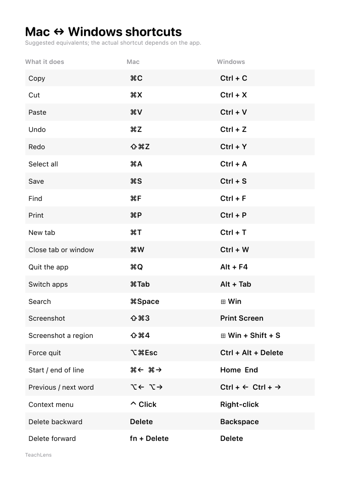

<p align="center"></p>

<h1 align="center">TeachLens</h1>

<p align="center">給 Mac 線上教學講師的螢幕講解工具：按鍵顯示 · Windows 對照 · 聚光燈 · 放大鏡 · 畫筆標註 · 即時字幕 · 課程模式 · 錄影</p>

<p align="center"><b>Fork 開發：<a href="https://www.facebook.com/Journal.of.Digital.Narrative">數位敘事力期刊 Journal of Digital Narrative</a></b></p>

<p align="center">
  <a href="https://github.com/FW1201/TeachLens/releases/latest">⬇︎ 下載最新版</a> ·
  <a href="#測試版介面">測試版介面</a> ·
  <a href="#安裝">安裝</a> ·
  <a href="#快速上手">快速上手</a> ·
  <a href="#功能說明">功能說明</a> ·
  <a href="#常見問題">常見問題</a> ·
  <a href="docs/DEVELOPMENT.md">開發者文件</a>
</p>

> English summary: TeachLens is a free, open-source macOS menu-bar toolkit for online teaching — keystroke display with Windows equivalents, spotlight, zoom, on-screen drawing, live captions with transcript export, course-mode presets and screen recording. Download the DMG from [Releases](https://github.com/FW1201/TeachLens/releases). Built on ZoomIt for Mac (MIT) and Keyviz (GPL-3.0); licensed GPL-3.0.

---

## 為什麼用 TeachLens

線上授課、錄製教學影片或示範操作時，學生常看不到你按了什麼、滑鼠在哪、你正在講哪一塊。TeachLens 常駐在選單列，一個快捷鍵就能：

- **讓學生看到你按的快捷鍵**：⌘⇧4、⌥←、⌘ 點擊……即時顯示在畫面上。
- **同步顯示 Windows 對照**：⌘C 下方顯示 Ctrl + C，用 Windows 的學生也跟得上。
- **把視線帶到重點**：聚光燈、游標光圈、搖動找游標、放大鏡、畫筆標註。
- **自動上字幕**：講話即時轉成字幕，課後匯出 .srt 逐字稿。
- **一鍵切換課程情境**：講解、程式示範、重點強調、休息。

---

## 測試版介面

以下畫面擷取自 macOS 上的 **TeachLens 1.3.0-beta.3** 建置（白板 `fa59335`，工具列與講義 `ddcd13a` 之後）。正式版與已發布的測試版可在 GitHub Releases 下載。[正式版](https://github.com/FW1201/TeachLens/releases/latest) · [所有版本](https://github.com/FW1201/TeachLens/releases)

### 多頁白板

上方工具列可選擇畫筆、形狀、顏色和匯出方式，下方可切換或新增頁面。詳見[多頁白板功能](#7-多頁白板whiteboard)。

<p align="center"></p>

### 圖形工具列與對照講義

左：展開的圖形工具列（中尺寸），最下方的斜線眼睛表示學生看不到這排工具。右：一鍵匯出的 Mac ↔ Windows 對照講義（A4 PDF）。

<p align="center">
  
  &nbsp;&nbsp;
  
</p>

---

## 系統需求

| 項目 | 需求 |
|---|---|
| macOS | 14 Sonoma 以上（macOS 26 以上會顯示 Liquid Glass 樣式） |
| 晶片 | Apple Silicon 與 Intel 皆可（Universal） |
| 權限 | 螢幕錄製、輸入監控；使用字幕時另需麥克風、語音辨識 |
| 費用 | 免費、開源（GPL-3.0），只在 GitHub 發佈，不上架 App Store |

---

## 安裝

### 1. 下載

到 **[Releases 頁面](https://github.com/FW1201/TeachLens/releases/latest)** 下載 `TeachLens-版本.dmg`。

### 2. 拖進「應用程式」

打開 DMG，把 **TeachLens** 拖到 **Applications（應用程式）**。

### 3. 第一次開啟（略過 Gatekeeper）

TeachLens 是開源免費版本，沒有付費向 Apple 公證，第一次開啟會被系統擋下。任選一種方式：

- **方法 A（系統設定，不用打指令）**
  1. 先雙擊 TeachLens 一次，出現被擋的訊息就按「完成」。
  2. 打開 **系統設定 ▸ 隱私權與安全性**，捲到最下面的「安全性」區塊。
  3. 按「已阻擋 TeachLens…」旁的 **強制打開（Open Anyway）**，輸入密碼或用 Touch ID 確認，再按 **打開**。
- **方法 B（終端機一行指令）**：打開「終端機」，貼上：

  ```bash
  xattr -dr com.apple.quarantine "/Applications/TeachLens.app"
  ```

> macOS 15 Sequoia 以後，「右鍵 ▸ 打開」已無法略過這個限制，請用上面兩種方法。macOS 14 仍可用右鍵 ▸ 打開。

> 若出現「已損毀，無法打開」，同樣用方法 B 解決；這是未公證 App 的系統提示，不是檔案真的壞掉。

### 4. 開啟權限

TeachLens 會在需要時請求權限，也可以從選單列 **TeachLens ▸ Check Permissions** 一次檢查：

| 權限 | 用途 | 位置（系統設定 ▸ 隱私權與安全性） |
|---|---|---|
| 螢幕錄製 | 放大鏡、截圖、錄影 | 螢幕與系統錄音 |
| 輸入監控 | 顯示按鍵與滑鼠點擊 | 輸入監控 |
| 麥克風 | 即時字幕、錄影收音 | 麥克風 |
| 語音辨識 | 即時字幕 | 語音辨識 |
| 相機（選用） | 錄影時的子母畫面 | 相機 |

**開啟「螢幕錄製」或「輸入監控」後，請結束並重新打開 TeachLens 才會生效。**

### 更新與移除

- **更新**：下載新版 DMG，覆蓋「應用程式」裡的 TeachLens 即可，設定會保留。
- **移除**：把 TeachLens 丟到垃圾桶；如要連設定一起清除，在終端機執行 `defaults delete io.github.fw1201.teachlens`。

---

## 快速上手

TeachLens 沒有 Dock 圖示，執行後在**畫面右上角選單列**出現金色放大鏡圖示，所有功能都在這裡。

第一次開啟會出現 **3 步驟新手引導**：
1. 選擇學生主要用 Mac 或 Windows。
2. 開啟權限。
3. 試按 ⌘C，看到按鍵膠囊就完成。

之後可從「總覽與測試」重新開啟引導。

**選單列（精簡為 6 項）：** 開始上課／下課、課程模式、圖形工具列、工具 ▸（所有工具與選項）、總覽與測試、設定。

**上課流程：**

1. **開始上課**（選單列第一項）：
   - 檢查螢幕錄製與輸入監控權限，缺少時會跳出可點「修正」的提示。
   - 套用目前的課程模式（未選擇時用「講解」），並打開圖形工具列。
   - 上課中選單列圖示會變成綠色。
2. **示範快捷鍵**：直接按，學生會看到畫面下方的按鍵膠囊。學生用 Windows 時，主要顯示可改成 Windows。
3. **強調重點**：工具列的聚光燈、畫筆、白板（含箭頭、方框、文字、雷射筆）。
4. **課堂活動**：工具列「計時」▸ 課堂倒數 1／3／5 分鐘，或按 **⌃⇧T**。
5. **下課**：一次還原上課前的設定。錄影還在進行時會提醒你存檔；錄影有字幕時，停止後會提示匯出 .srt。

**忘記快捷鍵？** 按住 **⌃（Control）** 約 1 秒，畫面中央會出現快捷鍵小卡，放開即消失。這需要輸入監控權限。

**緊急隱藏：** **⌃⌥⌘H** 會隱藏按鍵、字幕與聚光燈，再按一次恢復。

### 快捷鍵總表

| 功能 | 預設快捷鍵 |
|---|---|
| 顯示／隱藏按鍵 | ⌃0 |
| 聚光燈 | ⌃⇧0 |
| 即時字幕 | ⌃⇧C |
| 多頁白板 | ⌃⇧W |
| 靜態放大（凍結畫面） | ⌃1 |
| 畫筆標註（不放大） | ⌃2 |
| 休息計時器 | ⌃3 |
| 即時放大 | ⌃4 |
| 錄製全螢幕／區域 | ⌃5／⌃⇧5 |
| 截圖到剪貼簿／存檔／文字辨識 | ⌃6／⌃⇧6／⌃⌥6 |
| DemoMirror 鏡像 | ⌃9 |
| 長截圖到剪貼簿／存檔 | ⌃8／⌃⇧8 |
| 課堂倒數（角落小計時） | ⌃⇧T |
| 隱藏／恢復所有畫面提示 | ⌃⌥⌘H |
| 顯示快捷鍵小卡 | 按住 ⌃ 約 1 秒 |

所有快捷鍵都能在 **設定** 修改：按下快捷鍵按鈕後輸入新組合，Esc 取消。錄製期間 TeachLens 的快捷鍵會暫停，不會誤觸。

- 新組合若已被其他功能使用，會被拒絕，並在該列下方以橘色寫出被哪個功能占用。比對範圍包含 Shift／Option 衍生的組合。
- 文字辨識、自動打字這兩個選用快捷鍵，可按旁邊的 ⓧ 關閉。

---

## 設定與測試

選單列 ▸ **設定…** 打開設定視窗。所有分頁都使用同一種分組表單樣式（與 macOS 系統設定一致），頂端一行說明這頁的用途。左側由 17 個分頁合併成 8 組；有多個分頁的組別，頂端用圖示分段切換：

- **教學**：總覽與測試、課程模式、按鍵與游標（按鍵顯示＋聚光燈）、字幕、白板與計時（白板＋休息計時）
- **工具**：放大與標註（放大、即時放大、畫筆、文字）、擷取（截圖、錄影、長截圖）、進階（一般、自動打字、鏡像視窗）

**介面語言**：設定 ▸ 一般 ▸ 語言，可選「跟隨系統／繁體中文／English」，切換後立即生效。

### 總覽與測試（上課前先看這頁）

- **這個版本**：顯示版本號、建置 commit，以及是開發版還是正式版；「複製診斷資訊」可直接貼到問題回報。
- **課前檢查**：逐項顯示螢幕錄製、輸入監控、麥克風、語音辨識、相機是否已允許，未允許的可按「修正…」。
- **逐項測試**：每個功能都有「立即測試」按鈕，不用記快捷鍵。按鍵顯示有示範動畫（⌘C → ⇧⌘4 → ⌘Z ×3），**不需要任何權限**就能確認畫面效果；字幕也有不需要麥克風的示範。
- **課程模式試用**：逐一套用四種模式，最後按「回到原本設定」還原。
- **快捷鍵接收測試**：按任一 TeachLens 快捷鍵，這裡會顯示收到的功能名稱；沒有出現代表快捷鍵沒有送到 TeachLens（可能被其他 App 佔用）。

## 功能說明

### 1. 按鍵顯示（Keystrokes）

把你按的快捷鍵與滑鼠動作顯示在畫面上，學生不用猜你按了什麼。

- 修飾鍵依 Mac 慣例合併成一格（⌃⌥⇧⌘），主鍵用白色圓角塊。
- 連按同一組會顯示「×3」。
- **避開會議控制列**：預設開啟。下方的膠囊會往上移，不被 Zoom、Meet、Teams 的控制列擋住；字幕也會自動讓開，不和膠囊重疊。
- **大小**：小螢幕分享、一般、大教室投影三種預設。
- **分享中的螢幕**：雙螢幕時可指定學生看到的那一個，按鍵與字幕就固定顯示在那裡，不跟著游標跑到另一個螢幕。
- **密碼保護**：系統進入安全輸入（例如輸入密碼）時，會自動暫停顯示按鍵。
- **對照講義**：設定 ▸ 按鍵與游標 ▸「匯出 Mac ↔ Windows 對照講義（PDF）」，可產生一頁 A4 對照表發給學生。
- **顯示時機**：組合鍵按下就立刻出現，整組一起停留、一起淡出，不會一個鍵一個鍵消失。單按修飾鍵（例如先按 ⌘ 再按 C）不會先閃出一顆「⌘」。「只顯示快捷鍵」模式下，單獨的修飾鍵一律不顯示；改成「每個鍵」時，刻意按住 ⌥ 講解約 0.35 秒後才會顯示，放開 1 秒後消失。
- 開啟「減少動態效果」時，膠囊只淡入淡出，不做縮放。
- 滑鼠：⌘ 點擊、⌥ 拖曳、滾輪都會顯示；點擊位置出現漣漪（左鍵白色、右鍵橘色）。
- 預設只顯示「快捷鍵」（有修飾鍵的組合），打字內容不會露出；改成「每個鍵」前會先提醒，避免分享螢幕時露出私人內容。
- 背景三選一：**Liquid Glass**（macOS 26+）、霧面、實色（錄影或背景很花時最清楚）。

**設定位置**：選單列 ▸ 工具 ▸ 按鍵顯示選項，或 設定 ▸ 按鍵與游標（位置、大小、停留秒數、歷史筆數、快捷鍵）。

**自訂快捷鍵**：設定 ▸ 按鍵與游標 ▸「自訂快捷鍵」▸「新增快捷鍵…」，按下想示範的組合（可以是 F5、B 這類單鍵）。每一組可寫說明（例如「筆刷工具」）與 Windows 對照；按下時，膠囊下方會多一個紫色說明標籤，且「只顯示快捷鍵」模式下也一定會顯示。


### 2. Windows 對照

開啟後，每組 Mac 快捷鍵下方會出現藍色的「Windows 建議」對應按鍵，方便同時教 Mac 與 Windows 的學生。這是建議對照，實際快捷鍵可能依軟體而異。對照規則依 Apple 官方說明〈[Mac 上的 Windows 鍵盤對應鍵](https://support.apple.com/zh-hk/guide/mac-help/cpmh0038/mac)〉。

| Mac | Windows |
|---|---|
| ⌘C／⌘V／⌘Z | Ctrl + C／Ctrl + V／Ctrl + Z |
| ⇧⌘Z | Ctrl + Y |
| ⌘Q | Alt + F4 |
| ⌘Tab | Alt + Tab |
| ⌥⌘Esc（強制結束） | Ctrl + Alt + Delete |
| ⇧⌘3／⇧⌘4 | Print Screen／Win + Shift + S |
| ⌘←／⌘→ | Home／End |
| ⌥←／⌥→ | Ctrl + ←／Ctrl + → |
| ⌃ 點擊 | 右鍵 |
| Delete／fn + Delete | Backspace／Delete |

**開啟方式**：選單列 ▸ Keystroke Options ▸ **Windows 對照**，或 Settings ▸ Keystrokes ▸ 開啟 Windows 對照。

**以 Windows 為主**：學生大多用 Windows 時，可把主要顯示改成 Windows。

| 主要顯示 | 膠囊顯示 | 下方對照（需開啟對照） |
|---|---|---|
| Mac（預設） | ⌘C | 藍色「Windows 建議 Ctrl + C」 |
| Windows | Ctrl + C | 灰色「Mac ⌘C」 |

- 一般字母、數字在兩個系統相同，所以不論主要顯示選哪一個，都照原樣顯示。
- 改成 Windows 為主時，就算沒開對照也會生效；開啟對照後，下方才會加上 Mac 寫法。
- **設定位置**：Settings ▸ Keystrokes ▸ 主要顯示（Mac／Windows），或選單列 ▸ Keystroke Options ▸「Mac 為主、Windows 為輔」／「Windows 為主、Mac 為輔」。

### 3. 聚光燈與游標強調（Spotlight）

- **聚光燈（⌃⇧0）**：畫面變暗，只亮滑鼠周圍；形狀可選圓形或「寬條」（適合逐行讀文字）。
- **游標光圈**：滑鼠外圍一圈彩色光環（黃、青、粉、綠）。
- **搖動找游標**：左右快速搖動滑鼠，游標位置會出現放大光圈。

調整：選單列 ▸ Spotlight Options，或 Settings ▸ Spotlight（大小、暗度、顏色、快捷鍵）。

### 4. 放大鏡與畫筆標註（Zoom & Draw）

| 操作 | 說明 |
|---|---|
| ⌃1 | 凍結畫面並放大；滾輪或 ⌥↑／⌥↓ 調整倍率 |
| ⌃4 | 即時放大（畫面持續更新） |
| ⌃2 | 不放大，直接在畫面上畫 |
| 左鍵拖曳 | 畫筆；按住 Shift 畫直線、Control 畫矩形、Control+Shift 畫箭頭、Tab 畫橢圓 |
| R／G／B／O／Y／P／W／K | 紅、綠、藍、橘、黃、粉、白、黑；加 Shift 變螢光筆 |
| T | 打字標註（⇧T 靠右）；↑／↓ 或滾輪調整字級 |
| ⌃W／⌃K | 白板／黑板 |
| ⌘Z／E | 復原／清除 |
| ⌘C／⌘S | 複製／儲存目前畫面 |
| Esc 或右鍵 | 離開 |

### 5. 即時字幕與逐字稿（Live Captions）

- 按 **⌃⇧C** 開始，畫面下方即時顯示你說的話（兩行）；停頓後自動斷句。
- 語言：中文（台灣）、中文（简体）、English、日本語、한국어；支援的語言會在 Mac 本機辨識，不上傳雲端。
- **匯出**：字幕選項 ▸ 匯出逐字稿（.srt／.vtt／.txt）。
- **錄影字幕**：錄影時開著字幕，錄完選 **匯出上一段錄影的字幕（.srt）**，時間軸會對齊影片開頭，可直接匯入剪輯軟體或 YouTube。

### 6. 課程模式（Course Modes）

一鍵切換整組設定，切換時右上角會短暫顯示目前模式：

| 模式 | 按鍵顯示 | 聚光燈 | 游標光圈 | 字幕 | 其他 |
|---|---|---|---|---|---|
| 講解 | 快捷鍵 | — | ✓ | ✓ | |
| 程式示範 | 每個鍵＋歷史、放大 1.25 倍 | — | ✓ | — | |
| 重點強調 | — | ✓ | — | — | |
| 休息 | — | — | — | — | 開啟休息計時器 |

- **自訂模式**：調好設定後選 **將目前設定存成模式…**。
- **分享模式**：**匯出模式…** 產生 JSON 檔，其他老師用 **匯入模式…** 載入。
- 重開 TeachLens 會回到上次的模式（不會自動開麥克風或計時器）。

### 7. 多頁白板（Whiteboard）

按 **⌃⇧W** 打開獨立白板視窗，適合推導、畫圖解或課堂板書：

- 版面與圖形介面模式一致：頁面佔滿視窗，**上方**浮動玻璃工具列，**下方**是頁碼列。
- 上方工具列由左到右：
  - 畫筆（P）、螢光筆（H）、**雷射筆（L）**：紅色軌跡約 1.2 秒後淡出，不會留在頁面上
  - **形狀與文字**選單：直線、箭頭（A）、方框、文字（T，點一下就地輸入，按 Return 加入）
  - 橡皮擦（E）：形狀依外框判斷擦除
  - 7 種顏色、粗細（細／中／粗／特粗，也決定文字大小）
  - 背景（白板、黑板、方格、橫線，每頁可不同）
  - 復原（⌘Z）、插入螢幕截圖、全螢幕（⌃⌘F）、匯出
- 下方頁碼列：‹ 頁碼 ›（也可用 ← → 鍵）、新增頁面、「⋯」裡有清除本頁與刪除本頁。
- **點頁碼**會顯示所有頁面縮圖，點一下就跳到該頁；在縮圖上按右鍵可往前或往後移動頁面。
- 第一次開啟會提醒：會議軟體只分享簡報視窗時，學生看不到白板，請分享整個螢幕或改分享白板視窗。
- **插入螢幕截圖為新頁面**：把目前畫面拍下來放進白板再標註。截圖會縮到最寬 3200 像素，存檔較小、仍夠清晰。
- **匯出**：全部頁面存成一個 PDF，或本頁存成 PNG。
- 白板內容在背景自動保存，結束 App 時也會存檔；下次打開會接續上次的頁面與視窗位置。

### 8. 休息計時器、課堂倒數、截圖、錄影

- **⌃⇧T 課堂倒數**：在分享螢幕右上角顯示小型玻璃計時（預設 3 分鐘，工具列「計時」可選 1／3／5 分鐘），不遮住畫面。學生看得到；時間到會變紅、響一聲，5 秒後消失。

- **⌃3 休息計時器**：全螢幕倒數，可設定時間、顏色、背景圖與提示音（Settings ▸ Break）。
- **⌃6 截圖**：拖曳範圍複製到剪貼簿；⌃⇧6 存檔；⌃⌥6 辨識文字（OCR）。
- **⌃8 長截圖**：選取範圍後捲動，自動拼接成一張長圖。
- **⌃5 錄影**：全螢幕或區域（⌃⇧5），可收系統聲音、麥克風、加相機子母畫面；結束後可剪輯、淡入淡出再存檔。按鍵顯示與畫筆標註都會錄進影片。

### 9. 圖形工具列（浮動工具列）

不想記快捷鍵時，可從選單列 ▸ **圖形工具列** 開啟。「開始上課」與新手引導完成時也會自動打開。

- 螢幕右下角會出現一顆圓形按鈕，可以拖到任何位置，下次開啟時會停在同一處；離螢幕邊緣至少保留 16 pt。
- **按鈕大小**：更多 ▸ 自訂工具列 ▸ 按鈕大小（小／中／大）。靠右停駐時放大會往左長，不會貼到螢幕邊緣。
- 展開的工具列高度剛好容納目前的工具，不留空白。
- 按圓鈕後，工具圖示會在正上方直向展開，由圓鈕往上依序淡入。
- **預設只放 6 個工具**：課程模式、按鍵顯示、聚光燈、畫筆、白板、錄影。其餘（放大、字幕、計時、截圖）收在「更多」；可在「更多 ▸ 自訂工具列」勾選要放哪些。
- 滑過圖示時，提示文字會附上該工具目前的快捷鍵。
- 已開啟的功能會以強調色標示；收合時，圓鈕下方的彩色小點顯示哪些功能開啟中。錄影時圓鈕變紅，列中出現停止鈕。
- 閒置 5 秒後圓鈕會淡到 40%，滑鼠靠近即恢復。
- 列底的 👁 斜線圖示表示**學生看不到這個工具列**。
- 工具列會從圓鈕往上滑出，收合時再滑回去。開啟「減少動態效果」時改為淡入淡出。
- 再按一次圓鈕、按 Esc 或點其他地方即可收合。
- 工具列不會出現在錄影、截圖與長截圖中。放大、畫筆或休息計時期間會自動隱藏。

### 搭配視訊會議

在 Google Meet、Zoom、Teams 選擇**分享整個螢幕**（不是只分享單一視窗），學生才看得到按鍵顯示、聚光燈與字幕。

---

## 常見問題

**下載後被 Mac 擋下、無法打開或顯示「已損毀」？**
這是未經 Apple 公證的開源 App 的正常提示，檔案沒有壞。到 **系統設定 ▸ 隱私權與安全性**，按 TeachLens 旁的 **強制打開**；或在終端機執行 `xattr -dr com.apple.quarantine "/Applications/TeachLens.app"`。詳見 [安裝步驟 3](#3-第一次開啟略過-gatekeeper)。

**按鍵沒有顯示？**
確認「輸入監控」已開啟 TeachLens，並**重新開啟 App**。選單列 ▸ Check Permissions 可檢查狀態。預設只顯示快捷鍵，單純打字不會出現；要顯示全部，到 Keystroke Options 取消「Shortcuts Only」。

**按 ⌃1 一直跳出螢幕錄製設定？**
在系統設定開啟「螢幕錄製」後要重開 TeachLens。若仍失敗，在終端機執行 `tccutil reset ScreenCapture io.github.fw1201.teachlens` 後重新授權。

**字幕沒有反應？**
確認「麥克風」「語音辨識」都已允許；選單列 ▸ 字幕選項確認語言正確。

**快捷鍵和其他 App 衝突？**
到 Settings 對應分頁點快捷鍵按鈕重新錄製；按 Esc 取消。

**為什麼不上 App Store？**
App Store 版必須放進沙盒，會失去 DemoType 等功能，審核也較慢。TeachLens 選擇以開源方式在 GitHub 發佈，原始碼公開可檢查。

---

## 出處與授權

**Fork 開發：[數位敘事力期刊 Journal of Digital Narrative](https://www.facebook.com/Journal.of.Digital.Narrative)**

TeachLens 的 macOS 應用程式主體改作自 Microsoft 的 ZoomIt for Mac。按鍵與滑鼠顯示功能源自 Rahul Mula 的 Keyviz，並以 Swift 重新實作。GitHub 上的儲存庫源自 Keyviz。

| 專案 | 作者 | 授權 | 用途 |
|---|---|---|---|
| [ZoomIt for Mac](https://github.com/microsoft/Zoomit-Mac) | Microsoft Corporation | MIT | App 主體：放大、畫筆、計時器、截圖、錄影（上游 commit `45e15ac`） |
| [Keyviz](https://github.com/mulaRahul/keyviz) | Rahul Mula | GPL-3.0 | 按鍵與滑鼠顯示（以 Swift 重寫；原始碼保留於 [`Legacy/keyviz/`](Legacy/keyviz/)） |

TeachLens 整體以 **GNU GPL-3.0** 授權（[LICENSE](LICENSE)），ZoomIt for Mac 的 MIT 授權全文見 [ThirdParty/ZoomIt-Mac-LICENSE.txt](ThirdParty/ZoomIt-Mac-LICENSE.txt)，完整說明見 [THIRD_PARTY_NOTICES.md](THIRD_PARTY_NOTICES.md)。TeachLens 與 Microsoft、Sysinternals、Keyviz 專案無隸屬或背書關係。

開發、建置與發佈流程請見 [docs/DEVELOPMENT.md](docs/DEVELOPMENT.md)；截圖版本與補拍清單見 [docs/screenshots/README.md](docs/screenshots/README.md)。
