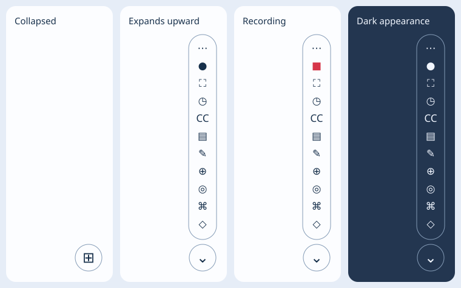

# TeachLens 圓形按鈕與上展工具列

**Claude Code 交接狀態：使用者已核可預覽（2026-11-24）。** 功能基準為 PR #6 的 b39e8a6。請先讀本文及預覽，依核可配置實作圓形按鈕與向上展開的單列圖示工具列。若 #6 已合併，由更新後的 main 開實作分支；否則基於 #6 最新提交另開分支。

此圖是靜態外觀稿，圖示為位置示意。實作採用 SF Symbols 和系統 Liquid Glass。

## 操作與實作

- 在既有 TeachLens 選單列加入「圖形介面模式」，預設關閉。以 AppKit NSPanel 承載 SwiftUI。圓鈕預設停靠螢幕右下角，可拖曳並記住位置，螢幕變更時限制在可見範圍。
- 按圓鈕在其正上方展開橫向單列工具列，右端對齊。再次點擊、Esc 或點外收合。停靠位置預留向上展開空間，靠邊水平平移，寬度不足把末端工具收進更多。
- 主列依序為課程模式、按鍵顯示、聚光燈、放大、畫筆、白板、字幕、休息計時、截圖、錄影及更多。更多含 OCR、長截圖、DemoType（依建置條件）與 DemoMirror。放大、截圖、錄影和課程模式沿用原生子選單。
- 使用現有 AppCommand、AppController 和課程模式控制器。提示文字顯示功能名稱與既有快捷鍵。VoiceOver 讀出名稱和狀態，支援 Tab、Return 及 Esc。錄影中顯示停止圖示並保持既有停止入口。擷取前隱藏面板，在支援的擷取路徑排除視窗，完成、取消或失敗後恢復收合。
- macOS 26 使用原生玻璃圓形按鈕及單一玻璃長條。以編譯和執行版本條件隔離玻璃 API，macOS 14／15 使用原生材質和控制項。沿用 L10n。
- 依循 [Apple Liquid Glass 自訂元件文件](https://developer.apple.com/documentation/SwiftUI/Applying-Liquid-Glass-to-custom-views) 與 [Apple SwiftUI 新版設計指引](https://developer.apple.com/videos/play/wwdc2025/323/)。

## 驗收與交接

- 圓鈕、向上展開的位置與圖示順序已核可。實作後提供 macOS 原生介面畫面，確認收合、展開、錄影中與深色四種狀態。
- 驗證各入口、快捷鍵狀態同步、權限拒絕、錄影停止、雙螢幕、靠邊與窄畫面。用 VoiceOver 與鍵盤走一遍，檢查繁中與英文、淺深色、減少透明度與動態效果。
- 檢查實際截圖及 MP4 是否帶入浮動介面。跑 macOS 15／26 CI，並在有 macOS 14 環境時驗證相容外觀。
- 開始、預覽完成及進入下一階段前檢查 Codex 剩餘額度。任一可讀視窗低於 10% 時，更新此文件所在 GitHub PR，記錄基準、進度、核可狀態和下一步，供 Claude Code 接續。
